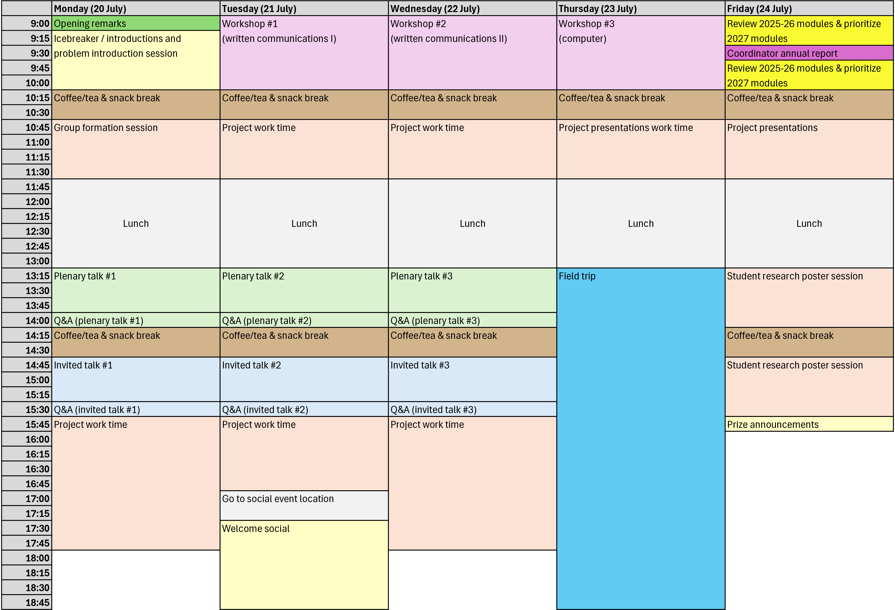

### Success! QCS Summer School 2026
The second annual QCS Summer School took place at the University of Waterloo July 20-24, 2026. We welcomed 
a larger group of students than we had last year for an exciting week of networking, technical talks, and 
workshops. Our students took on an ambitious hands-on training exercise in which student groups pitched mock 
research proposals to address an existing gap in climate research. The week concluded with a fantastic student 
poster session and cash prize announcements!

### Student poster session
Our dedicated QCS students prepared posters on their exciting QCS research and presented them at a poster 
session on July 24th. Check out the [poster archive](https://qcs-create2024.github.io/assets/posters2026/posters2026/), 
and the [complete collection of abstracts (.pdf)](https://qcs-create2024.github.io/assets/posters2026/abstracts2026.pdf) 
from the 2026 Summer School.

### Summer School materials and schedule
The group project info and related materials can be accessed [here](https://github.com/qcs-create2024/qcs-create2024.github.io/tree/master/assets/project2026).

Slides for the computer skills workshop, "AI Tools for Computing and Research", hosted by 
Dr. Derek Steinmoeller can be found [here](https://dsteinmoeller.math.uwaterloo.ca/slides/create-talk-2026-ai.html#1).

The summer school schedule is now live, check it out here (participants will receive a detailed version):

